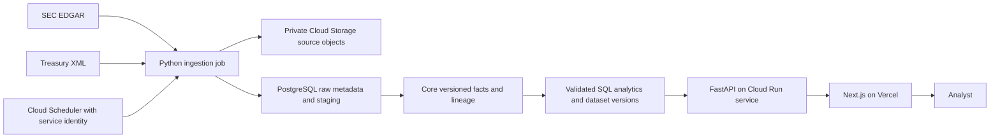

# Filing-to-Funding — final v1.2 architecture and audit

**A Corporate Liquidity and Financial Resilience Monitoring Platform**

**Status: v1.2 FINALIZED FOR IMPLEMENTATION REVIEW. AUTHORIZATION TO BEGIN IS PENDING.**

Finalized 19 November 2026 at the user’s request.

v1.2 is the final architecture baseline for the dedicated Filing-to-Funding Work workspace. The locked v1.1 draft is preserved as the original audit baseline. The architecture includes a local three-company pilot, a six-company first release, and a costed cloud release gate.

## 1. Audit conclusion and evidence boundary

The proposed stack is viable. The largest risks are financial meaning, temporal correctness, and overpromising completeness. v1.1 and its v1.0 financial specification already acknowledge quarterly cash-flow derivation, debt double-counting, source limitations, and multi-provider overhead. The deficiency is that these observations are not enforceable contracts with pass/fail release criteria.

v1.2 retains the main stack, sets the first release at six qualified issuers, defines the rules for historical views and financial calculations, and requires correctness checks before expanding the interface and releasing to the cloud. Universal filing extraction, a composite resilience score, and AI are deferred.

This is a design audit based on the recovered proposals and official documentation. No company-level dataset has been reconciled, cost benchmark measured, or security test executed. Candidate-company suitability and exact hosting bills remain unverified; the stage gates below make those checks mandatory after approval. The acceptance targets describe the evidence required at each gate.

## 2. Prioritized gap and risk register

P0 = critical financial or historical requirement that must be verified by G2. P1 = must pass before public release. P2 = later scope. All findings are OPEN; a specified remedy is not a tested closure. Owner labels describe future responsibilities, not additional staff requirements.

| ID / priority | Gap and consequence | Required remedy and closure evidence | Owner / gate |
|---|---|---|---|
| R01 P0 | “As-of” conflates financial period, filing availability, and ingestion time; future revisions can leak into history. | Separate three clocks and two historical modes; boundary fixtures prove later filings cannot alter earlier as-of results for the same dataset/methodology version. | Data / G1–G2 |
| R02 P0 | Company Facts is not a complete filing archive or full disclosure extractor. | Use it as a discovery/standard-fact source, preserve accession-level evidence, qualify coverage, reject unsupported metrics. No historical completeness claim from a current API download alone. | Data / G1 |
| R03 P0 | Amendments and comparative figures lack explicit precedence. | Version facts by semantic identity and accession. Newer compatible fact may supersede older; missing facts in amendments do not delete prior facts. Conflicts quarantine. Identify revisions without automatically calling every change a restatement. | Finance / G2 |
| R04 P0 | YTD, quarter, TTM, instant, and 52/53-week periods can be mixed. | Exact period intervals, basis compatibility, contiguous quarter tests, Q4 derivation checks, and transition-year exclusion. | Finance / G2 |
| R05 P0 | Debt/cash definitions can double-count or overstate accessible liquidity. | Document mutually exclusive components, lease policy, restricted-cash exclusion, gross-vs-carrying-debt labels, and unavailable states. Reconcile each issuer mapping. | Finance / G1–G2 |
| R06 P0 | Treasury curve could be mistaken for corporate financing cost; total debt is not immediately repricing debt. | User-specified exposed principal, rate/spread, horizon, and repricing share; distinguish hypothetical model from disclosed obligations. No inferred credit spread. | Finance / G2–G3 |
| R07 P0 | Missing, zero, invalid, stale, conflicted, and non-comparable values lack separate meanings. | Typed quality states and reason codes; null never becomes zero; ineligible measures cannot produce reassuring flags or ranks. | Data/API / G2–G3 |
| R08 P1 | Consolidated industrial issuers may contain financing businesses; acquisitions and spin-offs impair peers. | Qualify companies using filing evidence; tag consolidation basis and structural breaks; exclude unsuitable peers or visibly segregate them. Never derive industrial-only figures by subtraction without support. | Finance / G1 |
| R09 P1 | Five-year coverage is vague and insufficient input history may truncate TTM. | Fix a per-company coverage manifest, five complete fiscal years plus subsequent published quarters, and extra predecessor inputs where needed. Expose coverage limits and selected-universe bias. | Data / G1 |
| R10 P1 | Revised historical Treasury downloads may leak information or invent holiday observations. | Version raw snapshots, retain observation and retrieval dates, explicit last-observed carry-forward with age; historical vintage uncertainty visibly flagged. | Data / G2 |
| R11 P1 | API access, schema drift, filing backlog, and source restrictions threaten refresh reliability. | Identifying SEC User-Agent, shared conservative rate limiter, retries/backoff, historical submission-file traversal, source-policy register and schema fixtures. | Data / G2 |
| R12 P1 | Retried jobs may duplicate records or publish half-refreshed analysis. | Idempotent content hashes, per-source locks, bounded retries, checkpoints, staging validation, atomic dataset publication, last-good rollback. | Platform / G2–G4 |
| R13 P1 | Three providers create connection, region, billing, and configuration failure points. | One explicit network path; regional proximity, TLS verification, bounded connection pools and instance counts; no duplicate backend logic. | Platform / G4 |
| R14 P1 | Public API or Supabase access could expose raw/internal tables or costly queries. | Read-only public API role, private raw/core, restrict or disable unused Data API exposure, parameterized SQL and allowlisted sorts, request/query/export limits. Verify from an unauthenticated client. | Security / G3–G4 |
| R15 P1 | HTML filings and exports introduce active-content and spreadsheet-formula hazards. | External source links by default; sanitize any excerpts; prohibit arbitrary URL fetches; neutralize formula-leading CSV cells. | Security / G3 |
| R16 P1 | CI, previews, and ingestion credentials could reach production improperly. | Separate environments and roles; secrets manager, short-lived CI identity where supported, no production secrets in untrusted PR jobs; deployment environment approval controls. | Security / G4 |
| R17 P1 | Backups, migrations, and raw retention are named but not recoverable procedures. | Version migrations/methodology; off-site recoverable backups; immutable-by-application source objects with hashes; tested restore and dataset replay. | Platform / G4 |
| R18 P1 | Tests could merely reproduce the same wrong formula. | Independently reconciled filing fixtures with expected values, provenance checks, adversarial temporal tests, SQL integration tests, UI/API contract tests. | QA / G2–G4 |
| R19 P1 | A “successful” job can publish stale or incomplete data. | Monitor source freshness, coverage, exceptions, last published dataset, latency and cost; simulate failure and verify visible staleness plus operator alert. | Platform / G4 |
| R20 P1 | Charts and exports can hide basis differences and lose reproducibility. | Persistent as-of/period/mode controls, precise units, quality labels, source drilldown, accessible tables, and export metadata matching the view. | UX / G3 |
| R21 P1 | “Always available free demo” is not a reliable cost plan. | Choose paid/unpaid availability tradeoff, cost worksheet and owner-approved budget; include egress, logs, backups, builds and extra environments. | Owner / G4 |
| R22 P1 | Warning thresholds could imply calibrated credit risk. | Versioned explanatory rules, visible triggering operands, explicit incomplete state; no default probability or composite credit score. | Finance / G2–G3 |
| R23 P2 | Accounts, alerts, broad automated note extraction, and AI multiply scope. | Defer to separately approved increments after core release; require evaluation and privacy design before adding AI. | Product / G6 |

## 3. Financial and temporal contracts

### Historical selection

Store period_start/period_end or instant_date; filing accession/form/acceptance time and its original timezone; source-retrieved time; database recorded time; payload hash; transformation and mapping versions. Use CIK as issuer identity, with dated ticker/name aliases rather than ticker as a primary key.

Offer three explicitly named views:

1. **Latest reported:** latest compatible eligible disclosure for each period, with revisions visible. This is not guaranteed to be a formally restated series.
2. **Filed by date:** facts in supported filings available by the selected cutoff, reconstructed from retained evidence. State that coverage is 10-K/10-Q and amendments, not every item of public information such as earlier earnings releases.
3. **Platform snapshot:** reproduce a dataset actually ingested and published by this application. This exists only from the start of our own archived history.

Use date-only end-of-day America/New_York cutoffs for the first release, display that timezone, and preserve timestamp precision internally. Filing acceptance is evidence of filing timing, not proof of exact API dissemination latency. Do not claim intraday trading/backtest fidelity. Missing acceptance metadata must use a documented conservative fallback or exclude the item from strict historical mode, never silently use period end.

“Filed by date” applies to every operand, peer, rule, and rate context. A Q2 derivation cannot use a later revised Q1 that was unavailable at the cutoff. An amendment need not replace an entire statement. Compare equivalent units, dimensions, consolidation scope, intervals, and accounting basis before selecting a newer value. Keep links between original and revised facts; formal restatement status requires filing evidence.

For example: FY CFO 100 filed in February, revised CFO 80 filed in May. March filed-by-date must remain 100; latest reported may show 80. If the platform first downloads the filings in June, it can reconstruct those filing disclosures but cannot claim it actually served 100 in March.

The SEC aggregates standard, entity-wide facts; custom and dimensional disclosures need filing-level evidence. Its Frames endpoint aligns facts to calendar windows, making it unsuitable as the authoritative fiscal or historical selector. Current Company Facts downloads alone do not establish complete historical vintages. [SEC API documentation](https://www.sec.gov/search-filings/edgar-application-programming-interfaces)

### v1.2 metric definitions

All arithmetic uses decimal values with units; display rounding is separate. Preserve original precision/scaling when supplied, and do not invent precision absent from the source. Each formula has a version, sign convention, eligibility rule, inputs, and provenance.

| Metric | Contract |
|---|---|
| Working capital / current ratio | Current assets minus/divided by current liabilities from the same instant and compatible scope. Ratio unavailable for nonpositive denominator. |
| Cash ratio | Cash and cash equivalents divided by positive current liabilities. Restricted cash and investments are not silently included. |
| Debt | Non-overlapping current borrowings and noncurrent borrowings, with current maturities counted once. Finance/operating lease liabilities separately identified; exclude leases from base borrowing debt only when separable. Otherwise label combined basis and suppress incompatible peer ranks. |
| Net debt / debt-to-assets / cash-to-debt | Derived from the documented borrowing-debt basis. Negative net debt is retained. Denominator must be positive for ratios. Book carrying debt is not automatically contractual principal. |
| CFO / capex / FCF | CFO as reported on stated consolidated basis; capex = positive gross cash purchases of property, plant and equipment under the documented mapping; FCF = CFO − capex. Do not silently net sale proceeds, add acquisitions, or substitute an issuer-adjusted FCF. Label FCF as application-defined. |
| FCF margin | Comparable duration FCF divided by positive revenue. No mixing quarter cash flows with YTD revenue. |
| Cash conversion | CFO / net income only when net income is positive and periods/scopes match; otherwise “not meaningful,” with raw operands available. |
| Change/growth | Absolute changes always when comparable; percentage growth only with positive base. Display negative-base transitions without misleading percentage growth. |
| Quarter and TTM flows | Q2 = H1 − Q1; Q3 = 9M − H1; Q4 = FY − 9M, only when bases match. TTM = four contiguous compatible quarters. Never sum balance-sheet instants. |

Do not infer unrestricted or accessible cash solely from a cash balance. Undrawn revolvers, covenants, guarantees, debt maturities, floating-rate shares, hedges, and trapped cash are economically important but not reliably covered by standard facts. The first release must call its output **reported balance-sheet liquidity indicators**, not total available liquidity or certified refinancing capacity. Show a visible “not assessed” disclosure checklist and source links. Reviewed note extraction can be a later, separately scoped addition.

Suppress peer comparisons across incompatible accounting bases, fiscal transition periods, and structural breaks. Display actual fiscal dates and age differences even when periods have the same label. Unknown inputs produce an unknown flag state, not “no risk.” A 53-week year may be supported with explicit labeling, not silently converted to a 52-week year.

### Funding scenarios

Start with 2Y, 5Y, and 10Y nominal Treasury par yields and the 10Y–2Y difference. These are reference curve observations, not corporate borrowing quotes. Keep the series name, maturity, percent units, observation date, and retrieval vintage. Treasury's XML feeds and notices are the source contract. [Treasury feeds](https://home.treasury.gov/treasury-daily-interest-rate-xml-feed), [feed-change notices](https://home.treasury.gov/developer-notice-xml-changes)

Scenario input: selected/user-entered exposed principal P, repricing fraction f between 0 and 1, annual rate shock Δr in basis points, and horizon h in years. Simple incremental interest = P × f × (Δr / 10,000) × h. Example: $2bn × 25% × 100bps × 1 year = $5m. State that this assumes exposure over the full horizon, simple interest, and no hedges, amortization, fees, tax effects, or intra-period repricing schedule. A reference yield plus a user-entered spread may illustrate an assumed coupon; it is not an estimated issuer spread. Do not add a full hypothetical coupon to existing interest as if it were an incremental shock.

No floating-rate benchmark equivalence is implied by Treasury rates. Actual floating-debt modelling would require benchmark-specific terms and potentially SOFR, outside core scope. Historical rates must be on or before the selected cutoff; weekends retain the last observation with an age label. Historical downloaded rate revisions without vintage evidence are not guaranteed point-in-time correct and must be labelled accordingly.

## 4. Final v1.2 architecture

Keep a modular monorepo and one financial calculation path, without microservices, a warehouse, Redis, Kafka, Kubernetes, or Databricks.

**Frontend:** Next.js/React/TypeScript, Tailwind, shadcn/ui, ECharts, TanStack Query/Table as justified. Five pages retained. Client-side rendering of data-driven charts is sufficient; no SEO or server-rendering complexity without a user need. URL state includes company, period, historical cutoff, and mode. No financial logic duplicated in Next.js routes.

**API:** FastAPI/Pydantic, versioned REST/OpenAPI contract, generated frontend types, pagination and bounded filters. PostgreSQL SQL views/functions calculate standard metrics; Python owns ingestion and the small scenario calculator. Every response carries dataset_version, methodology_version, basis, coverage/quality metadata, and source references. Decimal money should cross JSON as documented decimal strings or another precision-preserving contract.

**Database:** Supabase-managed PostgreSQL, local PostgreSQL during development. raw stores source manifests, hashes, retrieval/run metadata and selected staging records; large payloads live once in object storage. core adds facts, contexts, units, issuer aliases, filings, reporting periods, versioned mappings, revision relationships and lineage edges. analytics adds parameterized temporal selection, metric results/quality, dataset manifests and warning definitions. A uniqueness key must include accession, concept, period, unit and context; company+period+metric alone destroys history. Index accessions and company/concept/period/availability. Use SQL migrations with tracked revisions; materialize only when measured performance requires it.

**Publication:** ingest into a candidate run, reconcile and validate, then atomically publish a dataset version. Retain previous versions and source links. API caches key on dataset, methodology, mode, cutoff, and filters so historical views cannot receive cached current values. Parallel or retried jobs cannot publish out of order.

**Hosting:** Vercel frontend, one Cloud Run API service, one scheduled job entrypoint with SEC/Treasury subcommands, Cloud Scheduler and private Cloud Storage, Supabase PostgreSQL. Cloud Run Jobs do background work; a Cloud Run service serves requests. Choose nearby available database/API regions and benchmark actual cross-provider latency. TLS is mandatory. Pool sizes × worker counts × max instances must remain below the reserved database connection budget, leaving room for jobs and administration.

This retains three vendors deliberately: familiar frontend deployment, managed PostgreSQL, and portable Python compute. It is manageable at this scale but not intrinsically simpler or cheaper than every alternative. Consolidating on GCP would add a different managed-database operating/cost profile; do not switch merely to claim “single cloud.” If the release cost or latency gate fails, bring a two-provider/container-frontend alternative back for review rather than silently change the approved architecture.

**Security boundary:** anonymous read-only research demo and bounded stateless scenario calculations; no public writes, user uploads, saved accounts, or public refresh endpoint. Use separate migration, ingestion, and API database roles. Raw/core tables remain inaccessible to anonymous browser clients, including through Supabase's separate interfaces. Public API is intentionally reachable but rate-limited, with strict input/query limits; CORS is not authentication. Admin operations use cloud identities. Restrict network fetching to known source endpoints, enforce response-size/time limits, and never render unsanitized filing HTML.

**Delivery:** Docker for local API/jobs/PostgreSQL, pinned dependencies and reproducible lockfiles, GitHub Actions for checks and controlled deployment. Keep application code portable and cloud configuration documented. Production credentials must never enter previews or untrusted fork workflows. Changes to schemas must be backwards-compatible with the deployed API or have a tested coordinated rollout and rollback.

## 5. Product scope and UX acceptance

First release: six qualified US GAAP industrial issuers; first vertical slice three. Five complete fiscal years plus later quarters available at the release cutoff, subject to explicit coverage. The previous watchlist is a candidate list, not a verified cohort. Select issuers only after a coverage/comparability matrix. Expansion to 10–12 requires the same qualification; it is not a condition of a credible first release.

1. **Overview:** universe, dated liquidity/cash-flow indicators, explainable flags, missing coverage, and freshness. No unvalidated ranking score.
2. **Company explorer:** standard metrics and selected statement lines, annual/quarter/TTM controls, revision comparison and provenance drawer. Do not promise complete standardized financial statements.
3. **Peer comparison:** compatible definitions and actual fiscal dates; age/basis differences visible; excluded data explained.
4. **Funding and scenarios:** curve context, explicit assumptions, baseline vs shock, units and sensitivity table; no forecast language.
5. **Data quality and filing history:** accepted filings, run status, conflicts, exclusions, revision evidence, definitions and source links.

Every number should answer: what does this measure, for which period, on which basis, available when, derived how, and from which filing? Keyboard navigation, screen-reader labels, non-colour-only warnings, accessible chart tables, responsive layout, loading/empty/error/stale states and shareable URLs are acceptance requirements. CSV exports include the same cutoff, dataset/methodology versions, units and quality states as the screen. No silently interpolated financial data. No “all clear” when required disclosures are missing.

Defer: authentication, saved workspaces, email alerts, intraday data, stock prices, IFRS/financial institutions, automated covenant analysis, complete maturity ladders, a credit score, forecasting, broad document search and LLM assistant. These deferrals should appear in the product limitations, not just developer notes.

## 6. Source policy, governance, cost and operations

SEC access must stay below its aggregate 10 requests/second limit across machines; propose a shared 2 requests/second ceiling with backoff, an identifying User-Agent, caching and stop/retry handling for blocks. No browser-direct SEC ingestion. Backfill historical submission files, not only the recent submissions array. [SEC developer guidance](https://www.sec.gov/about/developer-resources)

Maintain a source register with official endpoint, retrieval date, access/reuse policy, attribution, schema and refresh expectations. SEC describes government-created and EDGAR public filing content as reusable; do not extend that statement to unrelated stock art, logos or third-party subscriptions. Store relevant provenance and link to originals. [SEC reuse FAQ](https://www.sec.gov/about/webmaster-frequently-asked-questions)

Raw payloads and manifests should be retained for the published historical coverage and all released datasets; use content-addressed storage/deduplication. Record reviewer rationale for mapping changes. Export only necessary financial data; avoid copying incidental filing personal information into operational logs. Define log retention (proposed 30 days) and prohibit secrets in logs. Use append-only application permissions for source storage; hashes detect alteration but do not by themselves make storage tamper-proof. Keep database backups and replay sources outside the database failure boundary.

Cost is a release decision, not a free-tier promise. Supabase currently advertises Pro from $25/month with a first project and daily backups; free projects have limited capacity, may pause after inactivity, and do not include automatic backups. Extra projects, compute and PITR can add cost. [Supabase pricing](https://supabase.com/pricing), [backup guidance](https://supabase.com/docs/guides/platform/backups)

Vercel Hobby is restricted to personal/noncommercial use, so eligibility must be checked against intended use before choosing it. [Vercel Hobby](https://vercel.com/docs/plans/hobby)

Prepare an itemized worksheet: Supabase plan/compute/backups; Vercel plan and usage; Cloud Run CPU/memory/runtime and requests; Scheduler; Storage capacity/operations; cross-provider egress; registry/builds/logs; domain and taxes; staging overhead. A provisional $40–80/month planning envelope for a low-traffic paid-database demo is a design allowance, not a quote or authorized spending. Replace it with a calculator estimate and measured trial workload before release. [Cloud Run pricing](https://cloud.google.com/run/pricing)

Use min instances 0 initially and conservative max instances, bounded job retries/runtime and export size. Budget alerts alone do not cap spending. Current GCP documentation also describes spend-cap budgets for covered services; verify applicability and residual charges rather than treating them as universal caps. [Alerts-only budgets](https://docs.cloud.google.com/billing/docs/how-to/budgets), [spend-cap budgets](https://docs.cloud.google.com/billing/docs/how-to/budgets-spend-caps)

Proposed service targets: daily SEC refresh and Treasury refresh after its expected publication window, automatic next-run catch-up; ordinary data requests p95 below 2 seconds for a stated warm low-load benchmark, cold-start results reported separately; daily backups with RPO ≤24 hours and documented manual restoration within one working day. These are acceptance targets, not SLAs. Monitor coverage and last-successful publication independently from process exit status. Show last-good data during upstream outages with a stale banner. Alert the owner on consecutive failures, unexpected coverage loss, exhausted database connections and budget thresholds. Test source outage, partial run, overlapping run, bad migration, and restore scenarios.

## 7. Stage gates and evidence required

| Gate | Work permitted after relevant approval | Exit evidence |
|---|---|---|
| G0 — authorization to implement | Finalize and review v1.2. | Record explicit user authorization to begin implementation under the finalized architecture. |
| G1 — local feasibility and cohort | After G0: inspect source samples, define mappings and data contracts, build a local three-company ingestion slice. | Three eligible issuers, coverage matrix, source/legal register, signed-off metric dictionary, temporal model and independently reconciled sample filings. If coverage fails, revise scope before scaling. |
| G2 — correctness core | Local schemas, ingestion, temporal SQL and scenario engine. | All P0 semantics implemented and tested; golden data reconciles within documented filing precision; repeated jobs are idempotent; no future-data leakage; full lineage; conflicts block affected publication. |
| G3 — usable full stack | API and five frontend pages; expand to six qualified issuers. | OpenAPI contract checks; browser tests for cutoff/period/quality/export consistency; accessible tables and navigation; bounded unauthenticated API; all displayed values traceable; exclusions visible. |
| G4 — operational/release readiness | Prepare exact cloud configuration and deployment proposal; provision only within approved provider/spend scope. | Itemized budget and owner-approved spending, verified plan eligibility, security tests, restore/replay drill, failure alerts, migration rollback, performance results, clean deployment procedure and user release approval if not already explicit. |
| G5 — portfolio release | Deploy after the approval and G4 conditions. | Public HTTPS app, documented API, reproducible repo and demo dataset, architecture/ER diagram, methodology and limitations, test report, source-linked case study, short demo walkthrough. Verify live behavior. |
| G6 — optional expansion | Only separately approved extensions. | Coverage-qualified extra companies or evaluated note/AI features; no relaxation of core correctness. |

Required correctness cases: amended facts, later comparative revisions, duplicate facts, conflicting contexts, unavailable tags, zero/negative denominators, currencies and scale, YTD/Q4/TTM derivation, missing quarters, leap/53-week periods, transitions, acquisitions, historical cutoff boundaries, weekends/rate revisions, retries and interrupted publication. Synthetic cases prove edge behavior; accession-backed fixtures establish real-world fidelity. Default tests run offline against versioned fixtures; separate live source smoke checks detect source drift without making every build depend on network availability.

Portfolio claims must match demonstrated evidence: describe a six-company research platform with tested filing-history reconstruction, not a universal real-time risk engine. Provide an original-vs-revised fact case study, a YTD-to-quarter calculation trace, and a pipeline failure recovery example. Do not invent performance or impact statistics for the CV.

## 8. Decision record

The user requested “Finalise v1.2” on 19 November 2026. The architecture is finalized with the financial and historical rules, release scope, and stage gates documented above.

**G0 is pending.** The next step is explicit user authorization to begin the local three-company pilot. Cloud provisioning and deployment are governed by G4 and G5.
