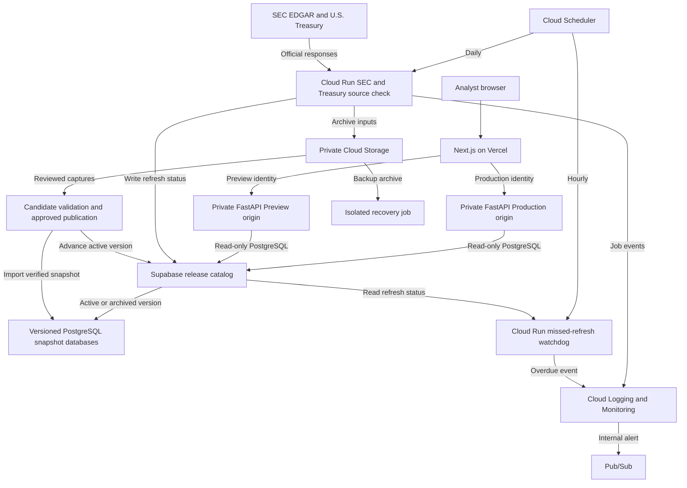
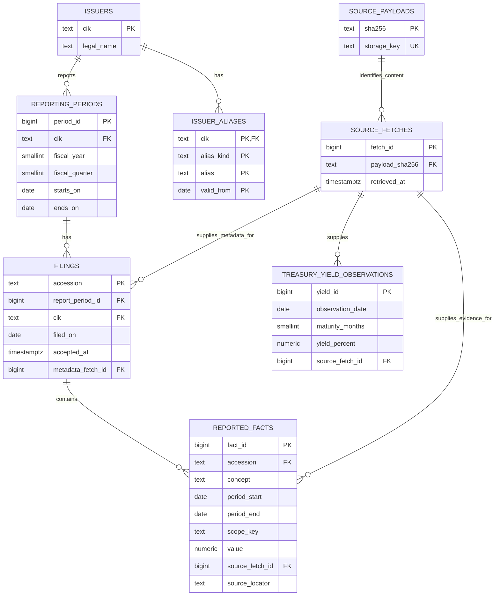

# Filing-to-Funding technical evidence

The public release combines historical SEC filing analysis, peer comparisons, and a Treasury-based funding scenario for six U.S. industrial companies. The verified release uses snapshot `v0004`, with SEC and Treasury coverage through 19 November 2026. It contains 160 filing records, 1,133 qualified statement observations, and 5,166 Treasury yields across 1,722 observation dates. [Live app](https://filing-to-funding.vercel.app/overview) · [Portfolio case study](portfolio_case_study.md) · [Reproduce locally](reproduce_locally.md) · [Cohort validation](local_release_validation.md)

## Hosted architecture

The browser calls a same-origin Vercel route. Its server-side workload identity obtains a short-lived credential for the corresponding Cloud Run service. The FastAPI services verify the selected dataset identity and query approved data through restricted PostgreSQL access. Production and Preview use separate invoker identities. The public URL stays on Vercel and the Cloud Run origins require authorization. [Hosting and budget](hosting_and_budget.md) · [Access controls](security_and_access.md)

The scheduled source check records freshness and stages newer inputs for review. Snapshot validation and publication are separate operations. A failed check preserves the last verified release. The watchdog reads the last successful source-check timestamp and alerts at the first hourly check after it is more than 36 hours old. Backups can be restored into scratch PostgreSQL for validation. [Refresh and recovery](refresh_and_recovery.md)

## PostgreSQL data model

The diagram shows the main tables and selected keys of one published snapshot. Each filing points to its reporting period and its metadata retrieval. Every reported fact points to its filing and its own source retrieval. Several retrievals can reference the same content hash. Treasury observations use the same provenance model. [Full data dictionary](data_dictionary.md) · [Schema migration](../database/migrations/001_pilot_storage.sql)

`raw` tracks source content and retrievals. `core` stores issuers, fiscal periods, filings, observations, and rates. The filing’s compound foreign key ties `report_period_id` and `cik` to the same reporting period. `analytics` calculates metrics and links compatible revisions. The separate `ftf_release.state` catalog stores the active version, retained snapshots, and refresh status. The API checks `app_snapshot.identity` inside the selected snapshot database before returning data. [Catalog SQL](../infrastructure/postgres/hosted_catalog.sql) · [API dataset access](../apps/api/dataset_access.py)

## Methodology and limits

| Area | What the release measures |
| --- | --- |
| Filing history | **Filed by date** uses New York end of day and applies the cutoff to every calculation input. **Platform snapshot** replays a published archive with its methodology. A later continuing-operations comparative retains its own accession and scope. [Historical accounting](historical_correctness.md) |
| Cash flow and comparisons | Standalone quarters subtract compatible year-to-date inputs, and trailing cash flow requires four contiguous compatible quarters. Free cash flow subtracts qualifying cash capex from operating cash flow. Peer comparisons require aligned reporting dates, compatible scopes, and common flow start dates. Missing or conflicting values carry explicit statuses. [Financial methodology](financial_methodology.md) |
| Debt and coverage | The dataset covers qualified U.S. industrial issuers. A. O. Smith, IDEX, and Lincoln Electric have filing history with sampled qualified statement coverage. Some periods and metrics remain unavailable, including borrowing ratios where the lease basis is unverified. The platform measures reported liquidity and cash generation. Detailed covenants, maturities, hedges, and borrowing capacity remain outside the release scope. [Cohort qualification](cohort_expansion.md) · [Financial ratios](financial_ratios.md) |
| Treasury and funding | The calculator uses 2-, 5-, and 10-year Treasury par yields as reference rates. A carried-forward curve retains its observation date and age. Archived annual files leave the original daily publication vintage unverified. The what-if calculation uses repricing principal, the assumed annual shock, and years to estimate simple incremental interest. [Treasury vintages](treasury_history.md#date-selection-and-vintages) · [Funding calculation](funding_scenario.md) |

## Test and release evidence

| Evidence | Result |
| --- | --- |
| Clean-checkout rehearsal | The tracked pilot fixtures loaded into an empty PostgreSQL 17.12 database and all three pilot SQL checks passed. From the merged source, 32 pipeline tests and 19 offline API boundary and funding tests passed. The local Next.js proxy returned all six current companies from the public API, and TypeScript passed. [Reproduce the checks](reproduce_locally.md) |
| Financial and temporal correctness | The validated three-company rebuild passed ten PostgreSQL checks and 37 Python tests. The six-company release checked filing dates, scope changes, source lineage, cohort metrics, and restored row counts. [Correctness review](correctness_review.md) · [Six-company validation](local_release_validation.md) |
| API, web, and release tests | The local release rehearsal passed 31 API tests and 11 Chrome tests. The Phase 5.1 merge re-ran 32 pipeline tests and seven API boundary tests. Production smoke checks covered all five views, all four snapshots, CSV export, the funding calculation, request limits, and denied anonymous access at the direct Cloud Run origin. [Release verification](performance_and_release_readiness.md#phase-51-production-release) · [Merge verification](https://github.com/Aadhi0105/Filing-to-Funding/pull/17) |
| Recovery | The controlled source-check failure preserved `v0004` and delivered the internal notification. The isolated backup download, verification, and restore of `v0003` and `v0004` took 5.83 seconds. The rollback rehearsal switched the test API between the archived and current datasets while the serving API continued on `v0004`. [Hosted recovery evidence](performance_and_release_readiness.md#hosted-sign-off) |
| Public performance | All 120 measured warm requests passed across six endpoints. The slowest endpoint p95 was 847.4 ms. Each endpoint had three warmups and 20 measured requests, at up to two requests per second and two in flight. Those timings describe the low-load production verification run. [Benchmark results](performance_and_release_readiness.md#phase-51-production-release) |

The local setup guide distinguishes the checked-in pilot fixtures, the live demo data, and an exact local replay from approved snapshot archives. [Reproduce locally](reproduce_locally.md)
